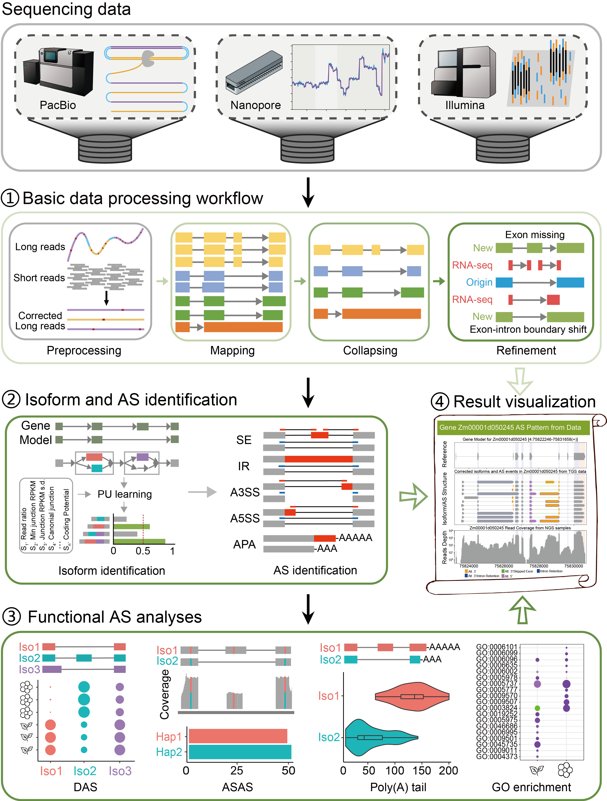

# iFLAS: an integrated Full-Length Alternative Splicing analysis tool

iFLAS is a "one-stop" alternative splicing (AS) analysis tool for full-length transcriptome data. It aims to provide a
general analysis framework for plant full-length AS studies, with diverse functions, accurate results and simple
operation. iFLAS integrates a number of analysis methods and tools, and analyses alternative splicing in three main
modules: 1) basic data processing, 2) isoform and AS identification, and 3) functional AS analysis.

The basic data processing module handles transcriptome data from different sequencing platforms, including
preprocessing of raw data, sequence alignment, removal of redundant isoforms and correction of splice sites. Splice
junctions from Illumina RNA-seq are used to check the isoform structures.

The isoform and AS identification module uses PU learning to identify novel isoforms, and characterizes AS events with a
hybrid-sequencing strategy, which reduces the problem of missing alternative introns that is common in NGS analysis.

The functional AS analysis module identifies differentially spliced events, allele-specific splicing events and
differences in 3' poly(A) tail length between splice isoforms, and performs GO enrichment analysis. The visualization
and report functions summarize the results in plots and an HTML report.



This is iFLAS 2.0.0b1, the Python 3 version of iFLAS. The version described in our paper (Python 2, here called
iFLAS 1) is kept under the tag [legacy-py2](https://github.com/CrazyHsu/iFLAS/tree/legacy-py2).

We have tested this version on simulated data, including reads simulated from the maize B73 v5 reference
(see [section 7](#7-testing)). It has not yet been run on real sequencing data, so please treat it as a beta release
and report problems in [Issues](https://github.com/CrazyHsu/iFLAS/issues).

Main changes from iFLAS 1:

- iFLAS runs on Python 3.10 or newer. iFLAS 1 needs Python 2.7.
- All dependencies are installed from conda environment files. Nothing has to be built by hand.
- A YAML configuration file and a sample table replace the .cfg file. `iflas migrate-config` converts an old .cfg file.
- `iflas init-ref` prepares the reference files from a genome FASTA and a GTF or GFF3 annotation.
- `iflas all` runs the whole pipeline. Each step can still be run on its own.
- Current versions of the external tools are used (ccs 6.4, lima and isoseq 26, minimap2 2.31, HISAT2 2.2.2,
  StringTie 3, cDNA_Cupcake 29, rMATS 4.4, R 4.5 with Bioconductor 3.22). Gene structure plots are drawn with
  pyGenomeTracks.
- Nanopore reads can be given as FASTQ files or as dorado BAM files. Poly(A) tail lengths come from nanopolish or
  from dorado.
- Many bugs are fixed. Some of the fixes change the results. They are listed in [CHANGELOG.md](CHANGELOG.md),
  together with the settings that restore the behaviour of iFLAS 1 where such settings exist.


## 1. Installation

iFLAS runs on Linux and has been tested on x86-64. We recommend installing it with conda (version 23.10 or newer, or
mamba). iFLAS uses four conda environments. The core environment `iflas` contains iFLAS and most of the tools.
cDNA_Cupcake, the PacBio tools and the R packages need other versions of Python or R, so they have their own
environments. iFLAS finds these environments by name and runs the programs inside them.

```bash
git clone -b py3 https://github.com/CrazyHsu/iFLAS.git
cd iFLAS

# core environment
conda env create -f environment.yml
conda activate iflas
pip install -e .

# cDNA_Cupcake, used by collapse and asas
conda env create -f environment-cupcake.yml
# ccs, lima and isoseq, used by preproc for PacBio raw data
conda env create -f environment-pacbio.yml
# rMATS and R, used by diff_as, go, characterize and report
conda env create -f environment-diffsplice.yml

iflas -h
```

The environment files allow a range of versions around the ones we tested. To install exactly the tested versions
(Linux x86-64), use the lock files in `envs/lock`:

```bash
conda create -n iflas --file envs/lock/iflas.linux-64.txt
conda activate iflas
pip install -r envs/lock/iflas.pip.txt
pip install -e .
conda create -n iflas-cupcake --file envs/lock/iflas-cupcake.linux-64.txt
conda run -n iflas-cupcake pip install -r envs/lock/iflas-cupcake.pip.txt
conda create -n iflas-pacbio --file envs/lock/iflas-pacbio.linux-64.txt
conda create -n iflas-diffsplice --file envs/lock/iflas-diffsplice.linux-64.txt
```

iFLAS activates the other environments directly. If this does not work on your system, set `IFLAS_CONDA_RUN=1` and
iFLAS will use `conda run` instead. To use an R installation outside conda, set `IFLAS_R_CONDA_ENV=local`.


## 2. Functions

```
$ iflas -h
usage: iflas [-h] [-V] <command> ...

iFLAS: integrated Full-Length Alternative Splicing analysis

command:
  <command>
    init-ref      Prepare the reference files and indexes from a genome FASTA and a GTF or GFF3.
    migrate-config
                  Convert an iFLAS 1 .cfg file into config.yaml and samples.tsv.
    all           Run the whole pipeline (preproc to palen_as) or selected stages.
    preproc       Preprocess raw PacBio, Nanopore and NGS reads (ccs, lima, isoseq, fastp, fmlrc2).
    mapping       Map long reads (minimap2) and NGS reads (HISAT2) to the genome; NGS junctions with regtools.
    collapse      Collapse corrected reads into high-confidence isoforms (cDNA_Cupcake).
    refine        Correct isoform strands and junctions (with NGS junctions) and assign isoforms to genes.
    pu_filter     Remove low-quality novel isoforms with PU learning.
    find_as       Identify AS events (IR, SE, A3SS, A5SS) from the high-confidence isoforms.
    find_pa       Identify poly(A) sites and APA in a sample (-b), or only cluster poly(A) sites.
    characterize  Summarize AS events: annotated and confident event lists, splice-site tables and comparison with the
                  reference.
    visual_as     Plot gene structures: reference models, iFLAS isoforms, NGS coverage and junctions (pyGenomeTracks).
    diff_as       Differential AS between conditions with rMATS (from config.yaml and samples.tsv, or a BAM table).
    asas          Identify allele-specific AS: phase the full-length reads of each locus with IsoPhase (--ref-genome
                  and --flnc) and test the haplotypes against AS isoform pairs.
    palen_as      Compare poly(A) tail lengths between AS isoforms and between APA sites (nanopolish or dorado tails).
    go            GO enrichment analysis and plots for one or more gene sets.
    report        Make plots and an HTML report from the finished stages.
```

`iflas <command> -h` shows the options of each command.

| Function | Description | Main tools (tested versions) |
| :-- | :-- | :-- |
| preproc | Raw data preprocessing and filtering; correction of long reads with NGS reads | ccs 6.4.0, lima 26.2.1, isoseq 26.2.0, fastp 1.3.3, fmlrc2 0.1.8 |
| mapping | Alignment of long and short reads | minimap2 2.31, HISAT2 2.2.2, StringTie 3.0.3, regtools 1.0.0 |
| collapse | Collapsing reads into isoforms | cDNA_Cupcake 29 |
| refine | Correction of strands and splice sites, assignment of isoforms to genes | In-house scripts |
| pu_filter | Filtering of novel isoforms by PU learning | In-house scripts, scikit-learn 1.9, CPC2 |
| find_as | Identification of AS events at the isoform level | In-house scripts |
| find_pa | Poly(A) sites and alternative polyadenylation | In-house scripts |
| characterize | Summary of AS events | In-house scripts, R 4.5.3 |
| visual_as | Gene structure plots | pyGenomeTracks 3.9 |
| diff_as | Differential AS between conditions | rMATS 4.4.0 |
| asas | Allele-specific AS and allele-specific expression | IsoPhase (cDNA_Cupcake 29), freebayes 1.3.10, salmon 2.8.0 |
| palen_as | Poly(A) tail length differences between AS isoforms and between APA sites | nanopolish 0.14.0, or dorado tail estimates |
| go | GO enrichment analysis | clusterProfiler 4.18.4 |
| report | Plots and HTML report | R 4.5.3, Gviz 1.54.0 |

[docs/external_tools.md](docs/external_tools.md) lists all external tools and how their command lines differ from the
versions used by iFLAS 1.


## 3. Preparing the reference

`iflas init-ref` derives the files iFLAS needs from a genome FASTA and a gene annotation, and prints the lines to put
under `reference:` in config.yaml.

```bash
iflas init-ref -f genome.fa --gtf genes.gtf -o ref/ --hisat2 -t 8
```

It writes a genePred file (`.gpe`), a BED12 file with gene names (`.bed`), the chromosome sizes (`.len.txt`), a minimap2
index (`.mm2`) and, with `--hisat2`, a HISAT2 index. A GFF3 annotation is converted with gffread (`--gff` instead of
`--gtf`). Compressed files can be given directly; they are decompressed into the output directory. For example, for the
maize B73 v5 reference from MaizeGDB:

```bash
wget https://download.maizegdb.org/Zm-B73-REFERENCE-NAM-5.0/Zm-B73-REFERENCE-NAM-5.0.fa.gz
wget https://download.maizegdb.org/Zm-B73-REFERENCE-NAM-5.0/Zm-B73-REFERENCE-NAM-5.0_Zm00001eb.1.gff3.gz
iflas init-ref -f Zm-B73-REFERENCE-NAM-5.0.fa.gz --gff Zm-B73-REFERENCE-NAM-5.0_Zm00001eb.1.gff3.gz -o ref/ --hisat2 -t 16
```

With 16 threads this took 14 minutes. The peak memory, 10 GB, was used by hisat2-build.

For GO enrichment, iFLAS needs a table of genes and GO terms (tab-separated, with the header `gene` and `go`, one term
per line), given as `options.gene2go` in config.yaml. The GO table of MaizeGDB can be converted like this:

```bash
wget https://download.maizegdb.org/Zm-B73-REFERENCE-NAM-5.0/Zm-B73-REFERENCE-NAM-5.0-GMs-GOTerms.csv.gz
python - <<'EOF'
import csv, gzip, re
with gzip.open("Zm-B73-REFERENCE-NAM-5.0-GMs-GOTerms.csv.gz", "rt") as f, open("gene2go.tsv", "w") as out:
    out.write("gene\tgo\n")
    for row in csv.DictReader(f):
        for term in sorted(set(re.findall(r"GO:\d{7}", row["obo_terms"] or ""))):
            out.write(f"{row['gene_model']}\t{term}\n")
EOF
```


## 4. Configuration

A run is described by two files: `config.yaml` with the reference and the parameters, and `samples.tsv` with one row
per sequencing library. Templates are in [examples/](examples/). Relative paths in both files are taken relative to the
directory of the file, and `${NAME}` is replaced by the environment variable `NAME`. Mistakes such as an unknown
`ref_strain`, a misspelled key or a wrong value type are reported before anything runs. An iFLAS 1 configuration file
can be converted with:

```bash
iflas migrate-config old.cfg -o config.yaml -s samples.tsv
```

Sections of `config.yaml`:

| Section | Content |
| :-- | :-- |
| reference | One entry per reference strain: `ref_strain`, `ref_genome`, `ref_gtf`, and the files printed by `iflas init-ref` |
| ccs, minimap2, collapse, pu_filter | Parameters of these steps. `minimap2.max_intron_length` (default 50000) also limits the introns kept after mapping. `pu_filter.random_state` seeds PU learning, so repeated runs give the same scores |
| options | `threads`, `memory`, `gene2go`, `merge_data_from_same_strain`, `ont_trim_polya`, `asas_ngs_confirm` (see below) |
| dirs | `out_dir` for the results; `tmp_dir` for temporary files (set it on servers with a small `/tmp`) |

Columns of `samples.tsv` (empty cells or `None` mean "not given"):

| Column | Content |
| :-- | :-- |
| sample_name | Name of the library |
| project_name | Project name, used in the output directories |
| ref_strain | The `reference` entry to use |
| strain | Strain of the library. Libraries of the same strain are merged (see below) |
| condition, replicate | Condition and replicate, used by diff_as |
| tgs_plat | `pacbio` or `nanopore`; empty for NGS-only libraries |
| strategy | For PacBio: `sequel` (subreads or CCS/HiFi BAM) or `rsii` |
| data_location | Raw long reads. PacBio: subreads BAM, CCS/HiFi BAM or a directory of them. Nanopore: FASTQ (gzip allowed), a directory of FASTQ files, or a dorado BAM |
| primer | PacBio primer FASTA for lima |
| data_processed_location | Full-length reads that are already processed (FASTA or FASTQ); the raw-data step is skipped |
| polya_location | An existing poly(A) tail table (nanopolish `polya_results.tsv`) |
| fast5_dir | Raw nanopore signal (fast5) of the reads, for nanopolish |
| ngs_left_reads, ngs_right_reads | NGS reads (FASTQ, gzip allowed) |
| ngs_reads_paired, ngs_reads_length | `paired` or `single`, and the read length (used by rMATS) |
| ngs_junctions | Optional junction BED file to use instead of the one from HISAT2 |
| use_fmlrc2 | Correct the long reads with the NGS reads of the same row using fmlrc2 (`true` or `false`) |

Notes on some settings:

- `options.merge_data_from_same_strain` (default `true`): `preproc` runs on each row, and the later steps run on one
  merged sample per strain, named `<strain>_all`. Merging pools the NGS libraries of a strain, so diff_as is skipped
  in this mode (see section 5).
- `options.ont_trim_polya` (default `true`): the basecalled 3' poly(A) of nanopore direct RNA reads is cut before
  mapping. The raw reads are kept for nanopolish. `false` gives the iFLAS 1 behaviour, which loses about a third of
  the nanopore reads in collapse.
- `options.asas_ngs_confirm` (default `true`): allele-specific AS and allele-specific expression are only reported for
  phased loci with at least one SNP that freebayes also finds in the NGS reads. IsoPhase sometimes reads alignment
  differences at splice sites as SNPs. `false` gives the iFLAS 1 behaviour.
- Nanopore fast5 files: if `data_location` is a fast5 directory, iFLAS calls Guppy (`guppy_basecaller`), which has to
  be installed separately and needs a GPU. Guppy is no longer developed, so we suggest basecalling with dorado
  elsewhere, giving the FASTQ or BAM file as `data_location` and the fast5 directory as `fast5_dir`. nanopolish reads
  fast5 only; POD5 files have to be converted first. For RNA004 data, dorado's own tail estimates
  (`dorado basecaller --estimate-poly-a`, kept in the BAM file) are used when no fast5 files are given.
- Large genomes: chromosomes longer than 536,870,911 bp get CSI instead of BAI indexes. Plots that read alignments in
  such regions with Bioconductor's Rsamtools are skipped, because Rsamtools cannot read there.


## 5. Running iFLAS

Run the whole pipeline:

```bash
iflas all -c config.yaml -s samples.tsv
```

The steps are preproc, mapping, collapse, refine, pu_filter, find_as, find_pa, characterize, visual_as, diff_as, asas,
ase and palen_as. A step is skipped, with a message, when a sample does not have the input it needs (for example ase
without NGS reads, or palen_as without tail lengths). `--stages` runs only the listed steps. Listed steps are not
skipped for missing input, with one exception: libraries without long reads always skip the long-read steps. `-j`
sets how many samples are processed at the same time, each with `options.threads` threads.

```bash
iflas all -c config.yaml -s samples.tsv --stages mapping,collapse,refine,pu_filter,find_as
```

When a run is resumed without `preproc`, iFLAS uses the reads that the earlier `preproc` produced (they are recorded in
`preprocess/preproc_outputs.json`).

Differential splicing needs separate alignments for each library, so it is run with merging turned off. In the
example below, `config_conditions.yaml` is a copy of config.yaml with `merge_data_from_same_strain: false` and its own
`out_dir`:

```bash
iflas all -c config_conditions.yaml -s samples.tsv --stages preproc,mapping,collapse,refine,pu_filter,find_as
iflas diff_as -c config_conditions.yaml -s samples.tsv -d root,leaf --pu-filter --go
```

With `--pu-filter`, rMATS uses all high-quality isoforms of the samples. Without it, rMATS only uses isoforms with
confident AS events, and events that are confident in only one condition can be missed.

The steps can also be run one at a time. `iflas preproc`, `iflas mapping` and `iflas collapse` work on the rows of
samples.tsv (all rows, or those given with `--sample`) without merging; the other steps work on the files of one
sample directory:

```bash
iflas mapping -c config.yaml -s samples.tsv
iflas collapse -c config.yaml -s samples.tsv
iflas refine --collapsed-gff collapse/tofu.collapsed.good.gff --ref-genome genome.fa -r ref/genome.gpe --ref-bed ref/genome.bed -o sample/
iflas pu_filter -b sample/ --ref-genome genome.fa --ref-bed ref/genome.bed
iflas find_as -b sample/ -r ref/genome.gpe
iflas go -tg target_genes.txt -s sample -bg gene2go.tsv
```

Plots and the HTML report are made from the finished steps:

```bash
iflas report -all -c config.yaml -s samples.tsv
iflas report -diff -c config_conditions.yaml -s samples.tsv
```

The report is written to `<out_dir>/reports/html/iflas_report.html`.


## 6. Output files

The results of each sample are written to `<out_dir>/<project_name>/<sample>/`:

| Directory | Content |
| :-- | :-- |
| preprocess/ | Processed long reads (pacbio/, nanopore/), filtered NGS reads (rna-seq/), corrected reads (fmlrc/) |
| mapping/ | Long read alignments (`flnc.mm2.sorted.bam`), NGS alignments, StringTie assemblies and junctions (rna-seq/) |
| collapse/ | Collapsed isoforms from cDNA_Cupcake (`tofu.collapsed.*`) |
| refine/ | Isoforms assigned to genes (`isoformGrouped.bed12+`), split into annotated and novel isoforms |
| hqIsoforms/ | High-quality isoforms after PU learning (`hq.collapsed.bed12+`), PU scores and features |
| as_events/ordinary_as/ | AS events (IR, SE, A3SS, A5SS); `LR/*.confident.*` are the events supported by NGS junctions |
| as_events/pa/ | Poly(A) sites and clusters |
| as_events/characterization/ | Annotated and novel event lists, splice-site motifs and summary plots |
| visual_as/ | Gene structure plots, one directory per gene |
| asas/, ase/ | Allele-specific AS (phased SNPs, AS events related to haplotypes) and allele-specific expression |
| palenAS/ | AS isoforms and APA sites with different poly(A) tail lengths |

Differential AS results are written to `<out_dir>/das/` (rMATS output, significant events in `*.sigDiffAS/` and the
GO results), and plots and the HTML report to `<out_dir>/reports/`.


## 7. Testing

```bash
pip install -e ".[dev]"
pytest -q
```

The tests run iFLAS on small simulated data sets in `test_data/`, whose genes, reads and expected results are known.
Tests that need a tool from an environment that is not installed are skipped. With all four environments the tests
take about 17 minutes.

We also checked this version on reads simulated from a real reference. `scripts/make_realref_data.py` simulates PacBio
HiFi, nanopore direct RNA (RNA002 and RNA004) and Illumina reads from 3,000 genes of a real genome and annotation, with
designed allele-specific splicing, allele-specific expression, differential splicing, alternative poly(A) sites and
tail length differences. `scripts/run_realref.sh` runs iFLAS on them, and
`IFLAS_REALREF=<run directory> pytest tests/test_realref.py` compares the results with the truth. On the MaizeGDB
B73 v5 reference (71,435 PacBio reads, 58,744 nanopore reads and 2.4 million NGS read pairs):

| Check | Result |
| :-- | :-- |
| Isoforms with at least 10 long reads recovered | 2,473 of 2,662 (92.9%) |
| Expected AS events found | 3,410 of 3,706 (92.0%), plus 70 other events (2.0%) |
| Allele-specific splicing | 42 of 60 designed genes, no other genes |
| Allele-specific expression | 40 of 40 designed genes |
| Poly(A) tail length differences | 39 of 50 designed genes, no other genes |
| Alternative poly(A) sites | 79 of 80 designed genes |
| Differential splicing (rMATS) | 27 of the 27 designed events that rMATS can define; none of the 40 genes designed without a difference; 24 events with low read counts in other genes |

The whole pipeline (`iflas all -j 1` with 16 threads) took 20 minutes with a peak memory of 14.6 GB, and the report 7
minutes. Nanopore reads are aligned to the genome FASTA, so minimap2 builds its index while aligning; on maize this
needs about 15 GB of memory. On a computer with 32 GB of memory, please use `-j 1`.

Before the fixes that change results were applied, we also compared this version with iFLAS 1 on the same simulated
data. Given the same NGS alignments, both versions produced the same refined isoforms (154 of 154), the same PU
features and nearly the same AS events. The few differences came from the random sampling in PU learning, which
iFLAS 1 does not seed. When each version made its own NGS alignments, the newer HISAT2, StringTie and regtools also
changed some junction counts.


## 8. Notes on the methods

- A5SS and A3SS events do not require the two isoforms to share the other splice site, so an event that changes both
  the donor and the acceptor is counted as both A5SS and A3SS.
- Mutually exclusive exons are not detected.
- Single-exon isoforms are not included in the high-quality isoforms. Intron retention in genes with two exons (which
  gives a single-exon isoform) is therefore not detected.
- Splice sites up to 5 bp apart are merged by collapse (cDNA_Cupcake `max_fuzzy_junction`, default 5). Lower
  `collapse.max_fuzzy_junction` to study such small differences, at the cost of more false isoforms from alignment
  errors.
- minimap2 does not recover internal exons of 9 bp or less, terminal exons of about 30 nt or less, or single introns
  longer than `minimap2.max_intron_length`.
- Full-length reads given in `data_processed_location` should have their poly(A) tails removed. Otherwise short
  transcripts can be lost in collapse, which requires 90% of a read to be aligned.
- When PacBio and nanopore libraries of one strain are merged, the merged sample is mapped with the minimap2 settings
  of the first long-read row in samples.tsv.
- Correcting nanopore RNA002 reads with fmlrc2 did not improve AS detection on simulated data; it can move the splice
  sites of minor isoforms to those of the major isoform. The `use_fmlrc2` column decides whether it is used.
- palen_as requires both a t-test and a Kruskal-Wallis test with p <= 0.001 and does not correct for multiple testing.
  With few reads per isoform, the Kruskal-Wallis test cannot reach this level (with 5 against 5 reads the smallest
  possible p-value is 0.008).
- asas reports an isoform as allele-specific when one haplotype has at least 5 reads and the other at most 3, with a
  chi-square test p <= 0.001. Only nearly exclusive allele-specific isoforms are reported.
- diff_as selects events by rMATS FDR <= 0.05 only, without a minimum read count or a minimum change in PSI.
- rMATS requires the flanking exons of an event to be identical. When the flanking exon is a terminal exon and the
  isoform ends differ, some A5SS and A3SS events cannot be tested.


## 9. Citation

Xu F, Liu S, Zhao A, Shang M, Wang Q, Jiang S, Cheng Q, Chen X, Zhai X, Zhang J, Wang X, Yan J. iFLAS:
positive-unlabeled learning facilitates full-length transcriptome-based identification and functional exploration of
alternatively spliced isoforms in maize. New Phytologist, 2024, 241(6): 2606-2620.
[doi:10.1111/nph.19554](https://doi.org/10.1111/nph.19554)


## 10. Contact

Please feel free to contact us at xufeng9527@cau.edu.cn, or open an issue on GitHub.
